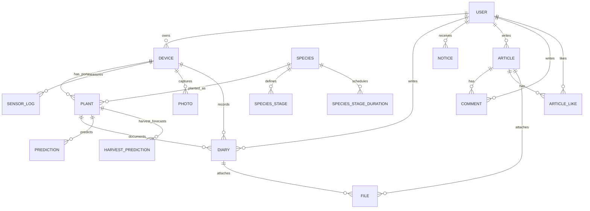

# GrowLab ERD (BE 기준)

붙여 넣은 ERD의 `Common`은 물리 테이블이 아니다. `created_at`, `updated_at`을 여러 엔터티에 반복해서 그리지 않기 위한 **공통 컬럼 표기**다. 이 문서의 핵심 업무 테이블에는 두 컬럼이 각각 존재하며, BE에서는 `TimeStamped`의 `@MappedSuperclass`로 매핑한다. `CopyOf...` 테이블들은 ERD 도구의 복제 상자이므로 실제 테이블이나 별도 관계로 세지 않는다.

## 핵심 관계

`DEVICE → PLANT ← SPECIES`가 다품종 재배의 핵심이다. `Plant`는 한 번의 재배를 나타내며, 종료 후에도 행을 보존한다. 수확은 `HARVESTED`, 병들거나 시들어 죽은 경우는 `DIED`로 기록한다. 같은 기기·포트에 다시 심으면 새 `Plant.id`가 생성된다. `(device_serial, active_port_index)`만 유일하며 종료된 행의 `active_port_index`는 `NULL`이다. 기기당 활성 포트는 최대 8개다. `Device`에 대표 `species_id`는 두지 않는다. 서로 다른 품종의 온도·습도·pH·TDS·조명 시간 범위가 모두 겹칠 때만 혼합 재배를 허용한다.

## 핵심 컬럼 (공통 `created_at`, `updated_at`은 표에서 생략)

| 테이블 | 기본키와 주요 컬럼 | 관계·제약 |
| --- | --- | --- |
| `user` | `id`, `username`, `email`, `password`, `user_role` | `username`, `email` 유일 |
| `device` | `serial_number`, `device_nickname`, `status`, `led_status`, `led_mode`, `led_on_time`, `led_off_time`, `photo_interval`, `port_status`, `user_id` | `user_id → user.id`, 미등록 기기는 `NULL` 가능. `species_id` 없음 |
| `species` | `id`, `name`, `days_to_mature`, `ai_prompt_guideline`, `category`, `difficulty`, `min/max_temperature`, `min/max_humidity`, `min/max_ph`, `min/max_tds`, `min/max_light_hours` | `name` 유일. 단계 목록은 아래 두 컬렉션 테이블에 저장 |
| `species_stage` | `species_id`, `stage_order`, `stage_name` | `species_id → species.id`, 단계 순서별 이름 |
| `species_stage_duration` | `species_id`, `stage_order`, `start_day` | `species_id → species.id`, 단계 순서별 시작일 |
| `plant` | `id`, `device_serial`, `species_id`, `port_index`, `active_port_index`, `name`, `stage_index`, `planted_at`, `germinated_at`, `matured_at`, `ended_at`, `end_reason`, `disease_result` | `device_serial → device.serial_number`, `species_id → species.id`, `UNIQUE(device_serial, active_port_index)`. 종료 후 행 보존. 기존 `plant_stage` 열 없음 |
| `sensor_log` | `id`, `serial_number`, `temperature`, `humidity`, `ph`, `tds`, `water_level_status` | `serial_number → device.serial_number`. 센서는 포트별이 아닌 기기 공통 |
| `diary` | `id`, `plant_id`, `device_serial`, `port_index`, `user_id`, `title`, `content`, `target_date`, `species_name`, `plant_name` | 새 일지의 `plant_id → plant.id`. 기존에 식물이 이미 삭제된 일지만 `NULL` 가능. 기기·포트·이름은 작성 시점 스냅샷 |
| `photo` | `id`, `device_serial`, `port_index`, `file_path`, `file_name`, `growth_stage_result`, `confidence`, `disease_result`, `disease_confidence`, `box_width`, `box_height`, `box_area`, `box_area_ratio`, `detections_json`, `selected_box_index`; 수확일 기능 추가 시 `plant_id`, `captured_at`, `observation_id` | `device_serial → device.serial_number`; 새 사진의 `plant_id`는 재배 회차 식별자다. 기존 사진은 이 세 컬럼이 `NULL`이며 물리적 `plant_id` FK를 만들지 않는다 |
| `prediction` | `id`, `plant_id`, `predicted_stage`, `confidence`, `prediction_mode`, `eta_lower_hours`, `eta_point_hours`, `eta_upper_hours` | 과거 단계 예측 기록을 보존한다. 새 상추 수확일 예측을 여기에 섞어 넣지 않는다 |
| `harvest_prediction` (수확일 migration 후) | `id`, `plant_id`, `device_serial`, `observation_id`, `photo_id`, `captured_at`, `predicted_at`, `received_at`, `model_version`, `feature_version`, `status`, `anchor`, `anchor_at`, `remaining_days`, `expected_at`, `features_json` | 새 관측만 저장한다. `plant_id → plant.id`; `(device_serial, observation_id)` 유일. 과거 사진으로 수확일을 임의 생성하지 않는다 |
| `notice` | `id`, `user_id`, `device_serial`, `message`, `is_read`, `notice_type`, `priority`, `additional_data` | `user_id → user.id`. `device_serial`은 현재 문자열 컬럼이며 물리 FK는 아님. 카메라 알림의 `plantId`는 `additional_data`에 저장; 환경 센서 알림은 기기 단위 |

커뮤니티의 `article`, `comment`, `article_like`, `file` 관계는 위 다이어그램처럼 유지한다. `article_like`는 `(user_id, article_id)`가 유일하다. 게시글·일지 첨부 이미지는 모두 `file`에 저장하며 `file_url`을 화면에 제공한다. 기기 카메라 사진과 분석 결과는 별도 `photo`에 저장한다. `image`와 센서 이상 지속시간 테이블 `sensor_anomaly`는 사용하지 않는다.

## 기존 DB 전환 순서

1. `migrations/20261005_device_port_species.sql`: 기존 `device.species_id`를 `plant.species_id`로 옮기고 기기 대표 품종 열 및 과거 `plant.plant_stage`를 제거한다. 식물의 품종을 복원할 수 없으면 `NOT NULL` 단계에서 중단한다.
2. `migrations/20261006_device_port_diary.sql`: 기존 `diary.plant_id`를 유지하고 기기·포트와 당시 이름을 스냅샷으로 채운다. 과거 포트 기반 일지에서 식물이 이미 삭제된 경우 `plant_id`를 추측해 채우지 않는다.
3. `migrations/20261007_plant_lifecycle.sql`: 재배 종료 컬럼과 활성 포트 유일성 제약을 추가한다.
4. `migrations/20261008_file_image_cleanup.sql`: 기존 `image`를 `file`로 옮긴다. 운영 검증과 백업 확인 전에는 `image`, `sensor_anomaly`의 물리 테이블을 보존한다.
5. `migrations/20261018_edge_harvest.sql`: 기존 `photo`에 nullable 컬럼과 인덱스를 추가하고 `harvest_prediction` 테이블을 새로 만든다. 기존 사진·단계 예측 행을 변경하거나 삭제하지 않는다. 운영 적용 여부는 `MIGRATION_AWS.md`의 최신 점검 결과를 확인한다.

위 SQL은 기존 DB의 데이터를 옮기기 위한 수동 마이그레이션이다. ERD의 `Common`이나 `CopyOf...`를 실제 테이블로 생성하지 않는다.
